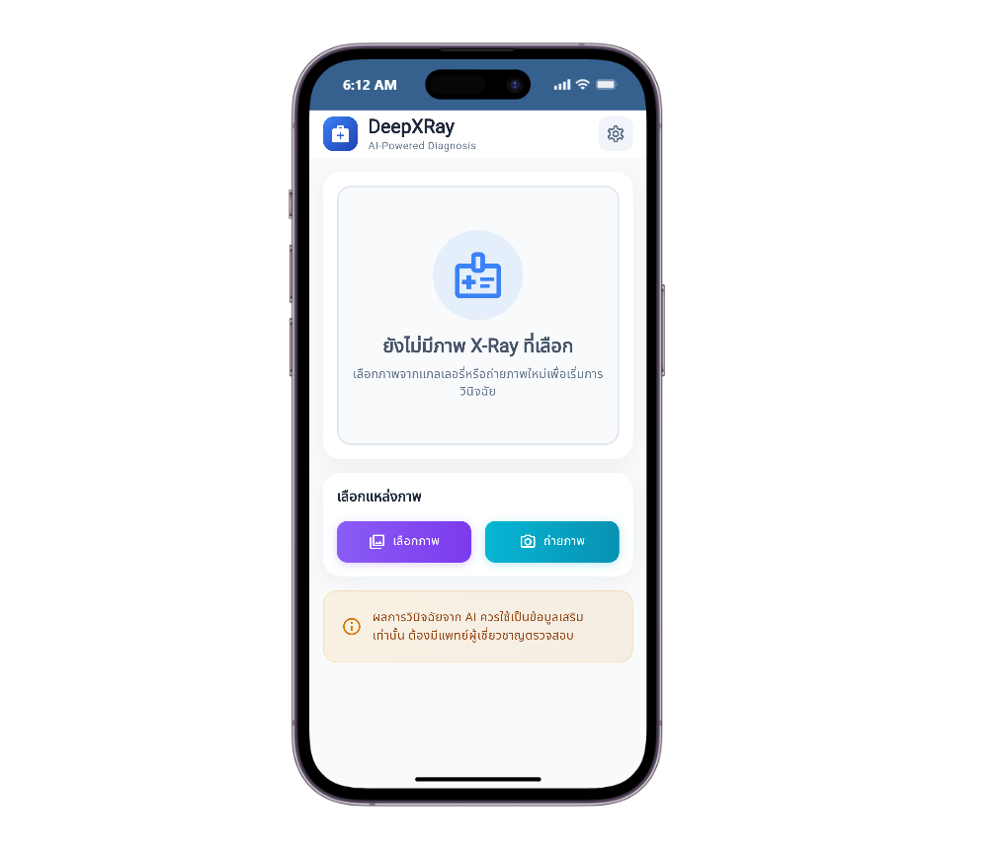
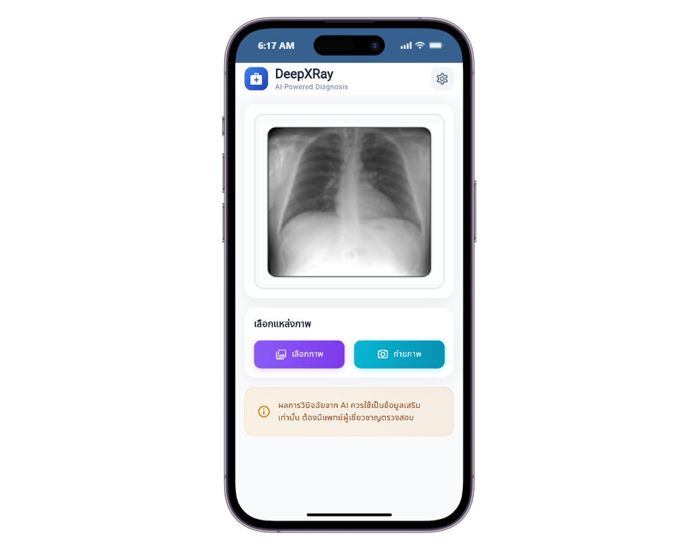
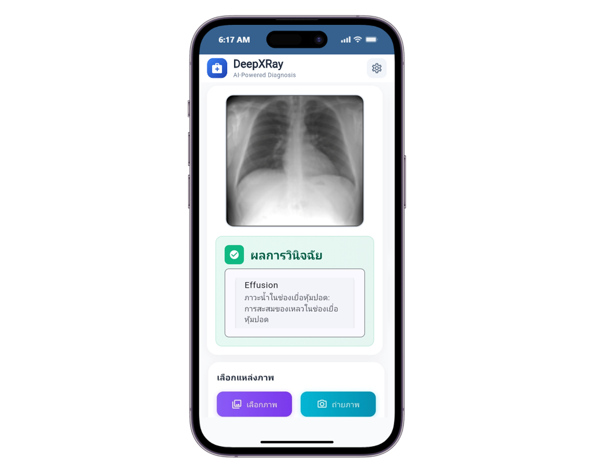

# DeepXRay

DeepXRay is a Flutter application for analyzing chest X-ray images. The mobile app sends an image to a Flask API, which runs a chest X-ray classification model and returns the three most likely findings.

## Screens

### Home

The home screen shows the DeepXRay dashboard and lets users select an X-ray image from the gallery or take a photo.



### Capture Image

Users can capture an X-ray image with the camera or choose one from the gallery. The selected image is previewed before analysis.



### Result

After analysis, the app displays the X-ray image and the three most likely findings, with confidence scores and descriptions.



## Features

- Select an X-ray image and submit it for analysis
- Display the top three predicted findings, confidence scores, and descriptions
- Run the Flask API in Docker with Docker Compose
- Connect the Android app to the API over a local network

## Tech Stack

| Component | Technology | Purpose |
|---|---|---|
| Mobile | Flutter, Dart | Android application |
| API client | Dio, `flutter_dotenv` | Send images and load the API URL |
| API | Python, Flask, Flask-CORS | Receive X-ray images and return predictions |
| Model | PyTorch, TorchXRayVision | Classify chest X-ray images |
| Image processing | Pillow, NumPy | Prepare images for model inference |
| Containerization | Docker Compose | Build and run the Flask API |

## Project Structure

```text
deep_xray/
├── backend/
│   ├── app.py                  # Flask API and X-ray prediction
│   ├── Dockerfile              # Backend image definition
│   ├── docker-compose.yaml     # Flask service and port mapping
│   └── requirements.txt        # Python dependencies
├── frontend/
│   ├── lib/                    # Flutter application source
│   ├── android/                # Android project
│   ├── pubspec.yaml            # Flutter dependencies and assets
│   └── .env.example            # Example API URL
└── README.md
```

## Requirements

- Docker Desktop with Docker Compose
- Flutter SDK and Android SDK
- An Android phone and the computer running Docker connected to the same Wi-Fi network
- The computer's LAN IP address for the Flutter API configuration

## Setup and Run

Start the Flask API before running the mobile app.

### 1. Flask API with Docker Compose

Run these commands from the project root:

```powershell
docker compose -f backend\docker-compose.yaml up -d --build
```

Check the service and view its logs:

```powershell
docker compose -f backend\docker-compose.yaml ps
docker compose -f backend\docker-compose.yaml logs -f flask
```

The API is published on port `5000` of the computer running Docker. The Compose file also requires `backend\.env`; create an empty file there if it does not exist.

Stop the API:

```powershell
docker compose -f backend\docker-compose.yaml down
```

### 2. Android Application

Find the computer's IPv4 address by running `ipconfig` in PowerShell and checking the Wi-Fi adapter. Configure `frontend\.env` with that address, without a trailing slash:

```env
API_URL=http://192.168.1.101:5000
```

Replace `192.168.1.101` with the computer's current LAN IP. If `frontend\.env` does not exist, copy the example file first:

```powershell
Copy-Item frontend\.env.example frontend\.env
```

Do not use `localhost` or `127.0.0.1` on a physical phone; those addresses refer to the phone itself. Both devices must be on the same network, and Windows Firewall must allow inbound connections to port `5000`.

Run the app from the project root:

```powershell
cd frontend
flutter pub get
flutter devices
flutter run
```

The `.env` file is bundled into the Flutter app at build time. Restart the app after changing `API_URL`; hot reload does not load the new value. For local HTTP development, Android may require `android:usesCleartextTraffic="true"` on the `<application>` element in `android/app/src/main/AndroidManifest.xml`. Allow cleartext traffic only for development; use HTTPS for production deployments.

## API Reference

### `POST /predict`

Analyzes an X-ray image. Send `multipart/form-data` with the field `image`.

```powershell
curl.exe -X POST http://localhost:5000/predict -F "image=@xray.jpg"
```

Returns `200` with a `predictions` array containing up to three findings. Each item includes `condition`, `confidence`, and `description`. Returns `400` if no image is provided and `500` if prediction fails.

## Notes

- The API has no authentication. Restrict access before exposing it beyond a trusted development network.
- The backend allows requests from all CORS origins. Restrict allowed origins before deploying to production.
- The Flutter `.env` file is bundled into the app; only put non-secret configuration such as the API URL in it.
- The LAN IP may change when the computer reconnects to Wi-Fi. Update `API_URL` and restart the app when it changes.
